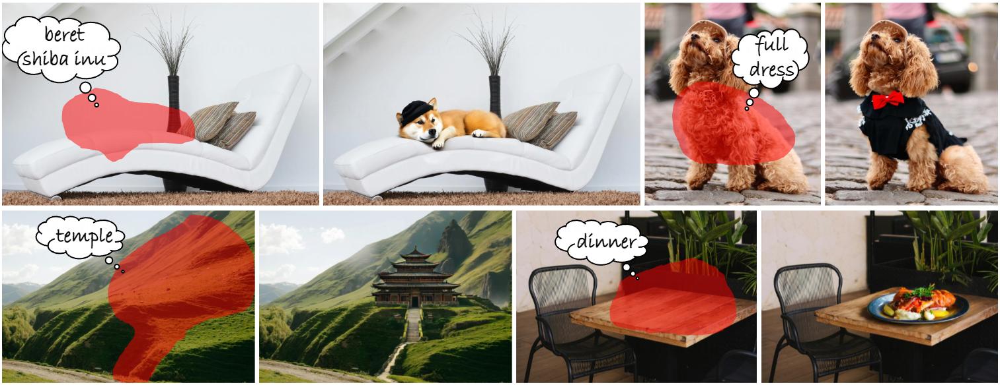

# Token Painter: Training-Free Text-Guided Image Inpainting via Mask Autoregressive Models (AAAI 2026)

[Longtao Jiang](https://longtaojiang.github.io/), [Jie Huang](https://huangkevinj.github.io/), [Mingfei Han](https://mingfei.info/), [Lei Chen](https://scholar.google.com/citations?user=l4QgYBIAAAAJ&hl=zh-CN), [Yongqiang Yu](), [Feng Zhao](https://scholar.google.com/citations?user=r6CvuOUAAAAJ&hl=en), [Xiaojun Chang](https://www.xiaojun.ai/), [Zhihui Li†](https://www.zhihui.li/),

Official code for **Token Painter: Training-Free Text-Guided Image Inpainting via Mask Autoregressive Models**.

[](https://arxiv.org/abs/2509.23919)
[](https://github.com/longtaojiang/Token-Painter)

Token Painter is a training-free text-guided image inpainting method built on top of the pretrained [NOVA](https://github.com/baaivision/NOVA) mask autoregressive model. It keeps background tokens fixed and generates only the masked latent tokens, while improving prompt faithfulness and context harmony with:

- **DEIF**: Dual-Stream Encoder Information Fusion in the frequency domain.
- **ADAE**: Adaptive Decoder Attention Score Enhancing.

## News

- [2026/05/22] :tada: Code release is prepared for public use.
- [2025/11/08] :tada: Token Painter is accepted by AAAI 2026.
- [2025/09/28] :sparkles: Release [paper](https://arxiv.org/abs/2509.23919).

## Abstract
> Text-guided image inpainting aims to inpaint masked image regions based on a textual prompt while preserving the background. Although diffusion-based methods have become dominant, their property of modeling the entire image in latent space makes it challenging for the results to align well with prompt details and maintain a consistent background.
To address these issues, we explore Mask AutoRegressive (MAR) models for this task. MAR naturally supports image inpainting by generating latent tokens corresponding to mask regions, enabling better local controllability without altering the background. However, directly applying MAR to this task makes the inpainting content either ignore the prompts or be disharmonious with the background context. Through analysis of the attention maps from the inpainting images, we identify the impact of background tokens on text tokens during the MAR generation, and leverage this to design \textbf{Token Painter}, a training-free text-guided image inpainting method based on MAR.
Our approach introduces two key components: (1) Dual-Stream Encoder Information Fusion (DEIF), which fuses the semantic and context information from text and background in frequency domain to produce novel guidance tokens, allowing MAR to generate text-faithful inpainting content while keeping harmonious with background context. (2) Adaptive Decoder Attention Score Enhancing (ADAE), which adaptively enhances attention scores on guidance tokens and inpainting tokens to further enhance the alignment of prompt details and the content visual quality. Extensive experiments demonstrate that our training-free method outperforms prior state-of-the-art methods across almost all metrics.

<p align="center">

</p>

## Installation

```bash
git clone https://github.com/longtaojiang/Token-Painter.git
cd Token-Painter

conda create -n tokenpainter python=3.10 -y
conda activate tokenpainter

pip install -e .
pip install gradio opencv-python tqdm pandas
```

## Checkpoint

Token Painter is training-free. It does not require an inpainting-specific checkpoint. By default, the scripts use the pretrained NOVA text-to-image checkpoint:

```text
BAAI/nova-d48w1024-sdxl1024
```

You can also pass a local checkpoint directory:

```bash
--model /path/to/nova-d48w1024-sdxl1024
```

## Gradio Demo

```bash
python scripts/demo.py \
  --model BAAI/nova-d48w1024-sdxl1024 \
  --device cuda:0 \
  --port 7860
```

Open `http://localhost:7860`, upload an image and a binary mask, then enter the text prompt. White mask pixels are treated as the region to inpaint.

## Single Image Inference

```bash
python scripts/infer.py \
  --model BAAI/nova-d48w1024-sdxl1024 \
  --image samples/origin/1.jpg \
  --mask samples/mask/1.jpg \
  --prompt "a full picture of a big blue ship." \
  --output outputs/ship.jpg \
  --seed 1237
```

Useful options:

```bash
--guidance_scale 5.0
--num_inference_steps 64
--num_diffusion_steps 25
--envratio 1.0
--no_adae
--cpu_offload
```

By default, the script crops or pads the input to NOVA's square resolution for inference and restores the result to the original image size.

## Benchmark Inference

The benchmark runner expects:

```text
data/EditBench/
  images/
  masks/
  mapping_file.json

data/BrushBench/
  images/
  masks/
  mapping_file.json
```

`mapping_file.json` should map image filenames to captions, for example:

```json
{
  "0001.jpg": {
    "caption": "a silver metal cat is sitting and with its tail wrapped around its body"
  }
}
```

Run EditBench:

```bash
python scripts/infer_benchmark.py \
  --model BAAI/nova-d48w1024-sdxl1024 \
  --image_dir data/EditBench/images \
  --mask_dir data/EditBench/masks \
  --prompt_file data/EditBench/mapping_file.json \
  --output_dir outputs/EditBench \
  --device cuda:0
```

Run BrushBench:

```bash
python scripts/infer_benchmark.py \
  --model BAAI/nova-d48w1024-sdxl1024 \
  --image_dir data/BrushBench/images \
  --mask_dir data/BrushBench/masks \
  --prompt_file data/BrushBench/mapping_file.json \
  --output_dir outputs/BrushBench \
  --device cuda:0
```

For a quick smoke test, add `--limit 2`.

You can also test the benchmark runner on the included sample:

```bash
python scripts/infer_benchmark.py \
  --model BAAI/nova-d48w1024-sdxl1024 \
  --image_dir samples/origin \
  --mask_dir samples/mask \
  --prompt_file samples/prompts.json \
  --output_dir outputs/sample \
  --limit 1
```

Generated files are written to:

```text
outputs/<benchmark>/
  inpaint/   # final inpainting results
  image/     # copied input images
  mask/      # copied masks
  concat/    # visual contact sheets
  result.json
```

## Acknowledgement

This project is built on the excellent [NOVA](https://github.com/baaivision/NOVA) codebase and pretrained models. We thank the NOVA authors and the broader open-source image generation community.

If you have questions, feel free to contact Longtao Jiang at `306900097@qq.com` or `taotao707@mail.ustc.edu.cn`.

## Citation

If you find this repository useful, please cite:

```bibtex
@inproceedings{jiang2026token,
  title={Token Painter: Training-Free Text-Guided Image Inpainting via Mask Autoregressive Models},
  author={Jiang, Longtao and Huang, Jie and Han, Mingfei and Chen, Lei and Yu, Yongqiang and Zhao, Feng and Chang, Xiaojun and Li, Zhihui},
  booktitle={Proceedings of the AAAI Conference on Artificial Intelligence},
  volume={40},
  number={7},
  pages={5397--5405},
  year={2026}
}
```

## License

The code is released under the Apache License 2.0. Please also follow the license terms of NOVA and the pretrained checkpoints you use.
